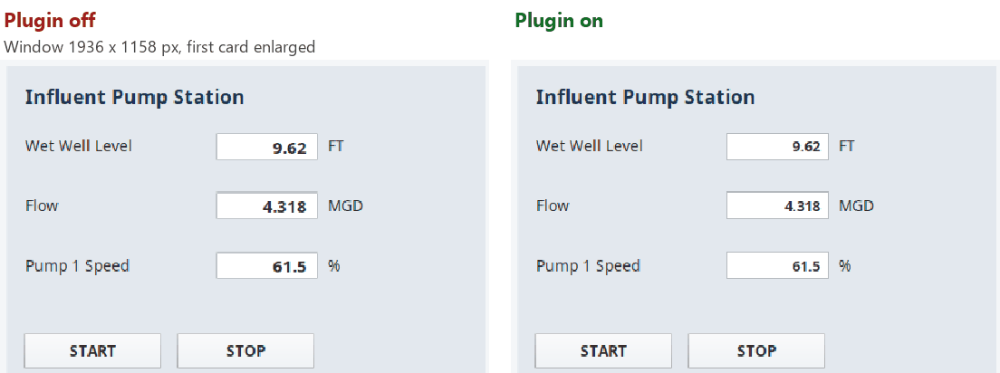
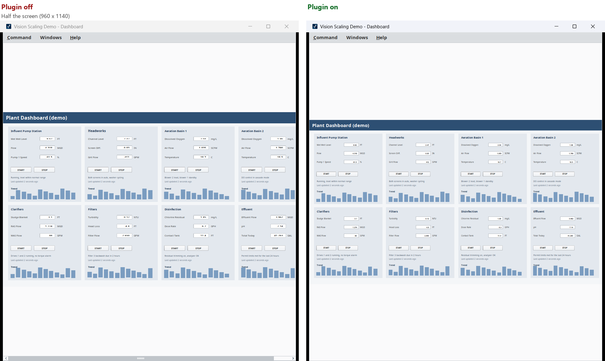
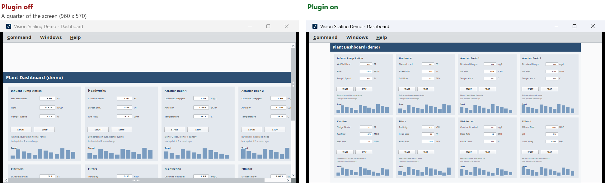
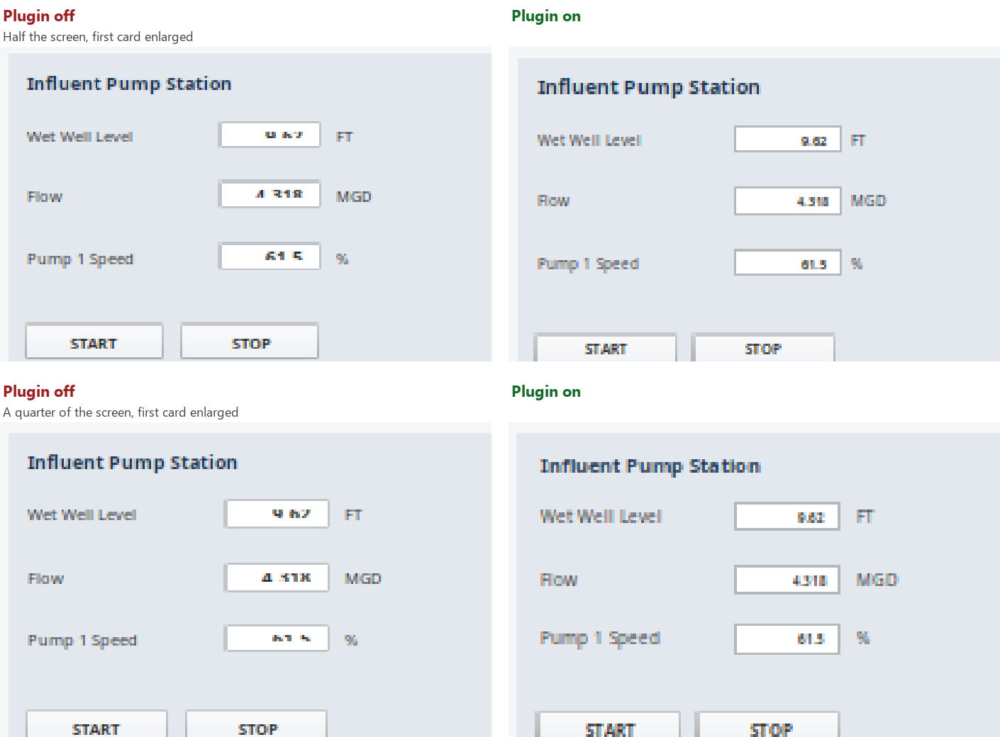
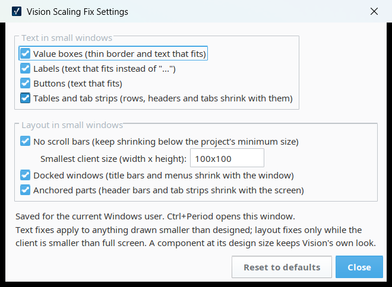

# Ignition Vision Scaling Fix

[](https://github.com/bearinmindcat/ignition-vision-scaling-module/actions/workflows/build.yml)
[](https://inductiveautomation.com/)
[](#requirements)
[](LICENSE)

Keeps numbers and labels readable when a Vision client window is smaller than its screens were designed for: half the screen (side by side or top and bottom), a quarter, a phone over Remote Desktop, or a PC at 125 % display scaling.

Without it, value boxes cut their numbers off: only a thin slice through the middle of the digits shows, so they read as dots and dashes, and labels end in "..." even when there is room. Below 800x600 the client also stops shrinking and adds scroll bars, and docked title bars and menus keep their full size. With it, the same boxes show the whole number, a little smaller, and the whole client shrinks evenly, like a picture. At full size nothing changes.

<p align="center">
  
  <br>
  <sub>Two Vision clients on Ignition 8.1.35 showing the same demo window while both shrink from full screen to 560 x 360 px. Left: module turned off. Right: module on. The card is enlarged so you can see the pixels.</sub>
</p>

Forum thread with the same problem: [Layout on numeric text field versus numeric label](https://forum.inductiveautomation.com/t/layout-on-numeric-text-field-versus-numeric-label/80923). The workarounds there (taller fields, or turning Scale Font off and adding a resize script to every field) mean editing every component; this module does it for every window, with nothing to change in the project.

## Before and after

The demo window (a made-up plant dashboard designed at 1920 x 1080, with value boxes 26 px tall) in two clients side by side. Click a picture for full size.







## Why Vision cuts things off

When the window is smaller than the design size, Vision's relative layout shrinks each box and the text inside it, but not the box's border. Ignition's look and feel gives a text field a fixed 8 px of border and padding in height (4 at the top, 4 at the bottom) at every size.

- **Full size:** a value box designed 34 px tall loses 8 px to the border. That doesn't matter: there's still room for the digits.
- **Half screen:** the same box comes out about 12 px tall. The border still takes 8 px, leaving 4 px for text that needs about 11. Only the middle slice of the digits shows.

Smaller causes:

- **"..." on labels and buttons:** Vision rounds the shrunk font to a whole point size (the smaller of the width and height ratios, rounded), sometimes up, so the text ends up a bit wider than its box.
- **Docked windows keep their size:** a title bar or menu docked at the edge stays its full pixel size, so the main screen is squeezed into whatever space is left.
- **Windows display scaling:** at 125 %, Java reports a 1920x1200 screen as 1536x960. To Vision the screen is 20 % smaller, so a window designed 1920 wide is shrunk to 80 % even when maximized, and more again at half screen.

## What it does

Each fix has its own check box in the settings window (**Ctrl+Period** in a client), all on by default.

**Text in small windows.** After Vision lays a window out, each component drawn below 97 % of its design height gets:

- **Value boxes:** a 1 px line border whose padding shrinks with the box, in place of the fixed 8 px, and text that fits.
- **Labels and buttons:** the exact (fractional) font size, shrunk in quarter-point steps until the text fits the height and width it has, instead of ending in "...". A button's margin shrinks with it. HTML text is left alone (it wraps instead).
- **Tables and tab strips:** an alarm status table's rows, header and Acknowledge/Shelve buttons, and a tab strip's tab fonts, padding and spacing, shrink with the component. Vision's own layout leaves these at full size.

**Layout in small windows.** While the client is smaller than its screen's full size, it shrinks as one picture:

- **No scroll bars:** Vision doesn't lay its screens out smaller than the project's Minimum Size (Project Properties → Vision → User Interface, 800x600 by default), and adds scroll bars below that. The module lowers that limit (100x100 by default, adjustable in the settings window) so the whole screen stays in view.
- **Docked windows:** a title bar or menu docked at an edge keeps its pixel size in Vision, so in a small window it takes most of the space. The module scales each docked window's thickness by how much smaller than full screen the client is. Vision's dock layout uses each docked window's current width or height.
- **Anchored parts:** components anchored to an edge (a header bar, a bottom tab strip) keep their pixel size in Vision and overlap the shrinking rest. The module lays them out as relative components (their layout flags) while the client is small.

A maximized client is never changed by the layout fixes, and components back at (nearly) their design size get Vision's own border, font and layout back. Nothing is saved to the project, and uninstalling the module puts everything back in open clients right away.



Vision re-applies its own rounded font on every layout pass whenever the rounded size differs from the component's current one. So the module also writes its size into the component's layout font ratios: Vision's next pass arrives at the same size and leaves the font alone, instead of the two undoing each other. If something keeps changing a component back at the same size (more than 5 times a second), the module leaves it alone for 5 seconds, then tries again.

## What it doesn't fix

- **Proportions:** Vision keeps a screen's proportions, so in a tall, narrow window the screen comes out small with blank space above and below.
- **Very small text:** at a quarter of the screen and below, text is whole but small. A button 20 px wide can't show readable text either way.
- **Trade-off:** labels that Vision ended with "..." now show their whole text, but smaller.

Java can also zoom the whole client evenly, on a PC that always runs it small: `-Dsun.java2d.uiScale=0.5` makes Java report the screen twice as large, so Vision lays screens out at full size and Java draws them at half size. It works together with this module. In our tests (Vision Client Launcher 1.1.35) the launcher's JVM arguments reached only the launcher itself, not the client it starts; setting `JAVA_TOOL_OPTIONS=-Dsun.java2d.uiScale=0.5` before starting the launcher did reach the client.

## Requirements

- Ignition 8.1.35 or newer 8.1 (8.3 isn't supported yet)
- Vision clients (the Designer keeps Vision's own behavior while windows are edited; not Perspective)

## Installation

1. On the Gateway, go to **Config → Modules → Install or Upgrade a Module** and upload the `.modl`.
2. Restart the Vision clients (it was tested with newly started clients).

An unsigned build needs `wrapper.java.additional.N=-Dignition.allowunsignedmodules=true` (the next free `N`) in `ignition.conf` and a Gateway restart.

## Settings

**Ctrl+Period** in a Vision client opens the settings window, and so does `system.visionscaling.openSettings()` (for example from a client menu item). Changes apply at once and are saved for the current Windows user.

An administrator can set a fix for every user of one PC with a Java system property on the client, for example through `JAVA_TOOL_OPTIONS` before starting the Vision Client Launcher. A fix set this way is locked in the settings window.

| Property | What it does |
| --- | --- |
| `-Dvisionscaling.disabled=true` | turns the whole module off in that client (useful for comparing with and without it) |
| `-Dvisionscaling.fields=false` | value boxes |
| `-Dvisionscaling.labels=false` | labels |
| `-Dvisionscaling.buttons=false` | buttons |
| `-Dvisionscaling.parts=false` | tables and tab strips |
| `-Dvisionscaling.noScrollBars=false` | keeps the project's minimum size and its scroll bars (`-Dvisionscaling.minSize=off` too) |
| `-Dvisionscaling.minSize=640x480` | the smallest client size when scroll bars are off (100x100 by default) |
| `-Dvisionscaling.docks=false` | docked windows |
| `-Dvisionscaling.anchored=false` | anchored parts |
| `-Dvisionscaling.debug=true` | writes a trace to `visionscaling-debug.txt` in the temp folder |

## Building

```
./gradlew build             # build/Vision-Scaling-Fix.unsigned.modl
```

Needs JDK 17 or newer (JDK 25 is too new for Gradle 8.10). After changing the version in `gradle.properties`, run `./gradlew clean build`.

To sign the module, set `ignition.signing.keystoreFile`, `keystorePassword`, `certFile`, `certAlias` and `certPassword` in `~/.gradle/gradle.properties`. The build then also writes `build/Vision-Scaling-Fix.modl`.

## License

[MIT](LICENSE)
